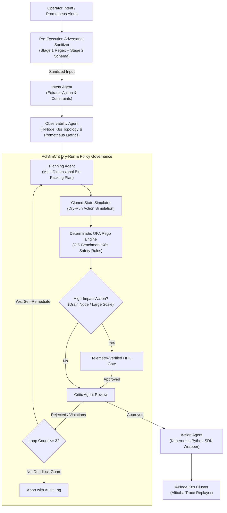

# GuardEdge-K8s: Policy-Enforced and Adversarial-Resilient Agentic Orchestration for Cloud-Native Kubernetes Clusters

> **FAST-NUCES Islamabad — AI4015: Agentic AI (Phase 2 Implementation)**  
> **Repository:** [agentic-cloud-manager](https://github.com/NaveedAhmed5/agentic-cloud-manager)  
> **Course Project:** Empirical Replication, Gap Identification, and System Extension of *AgentEdge (IEEE/ACM 2024)*

---

## 👥 Group & Project Information

- **Project Title:** GuardEdge-K8s: Policy-Enforced & Adversarial-Resilient Agentic Orchestration for Cloud-Native Kubernetes Clusters
- **Institution:** National University of Computer and Emerging Sciences (FAST-NUCES), Islamabad
- **Course:** AI4015 — Agentic AI (Fall 2026)
- **Team Members:**
  - **Student 1:** Naveed Ahmed (22i-0889)
  - **Student 2:** Mubariz (22i-1104)
- **Instructor / Course Lead:** Dr. [Instructor Name]
- **Target Paper Replicated:** *AgentEdge: An Edge-Cloud Collaborative Multi-Agent System with Action Simulation and Critic Feedback* (IEEE/ACM, 2024).

---

## 📖 Executive Summary

The base paper (**AgentEdge**) introduced an innovative multi-agent architecture (**PARES**: *Perceive, Act, Reflect, Execute, Simulate*) featuring an offline dry-run action simulator and critic feedback loop (**ActSimCrit**). However, empirical evaluation revealed three fundamental operational and safety gaps when attempting to deploy this architecture to cloud-native production environments:

1. **Gap 1 (Simplistic 2-Node Topology & Synthetic Toy Workloads):** The base paper evaluated solely on a synthetic 2-node edge/cloud setup lacking Kubernetes control-plane semantics, node taints, namespace boundaries, heterogeneous allocatability, or real cloud-scale trace dynamics.
2. **Gap 2 (Stochastic LLM Critic & Unbounded Reflection Deadlocks):** The base paper relied entirely on an unguided LLM Critic to review operational plans, leading to an empirical **2.67%–15.0% policy breach rate** (approving dangerous privileged containers) and a **25.67%–37.67% reflection deadlock frequency** where agents enter endless negotiation loops on Kubernetes.
3. **Gap 3 (Vulnerability to Adversarial Injection & Telemetry Poisoning):** AgentEdge completely assumed trusted inputs. When subjected to direct prompt injection overrides or poisoned Prometheus alert labels, the planner uncritically executed privileged container deployments, container breakouts, and destructive actions.

**GuardEdge-K8s** addresses all three gaps through a unified, production-grade agentic control plane:
- **Gap 1 Solution:** High-fidelity **4-node Kubernetes multi-node emulator** driven by **100 locked scenarios derived from Alibaba Cluster Trace v2018**, providing multi-dimensional bin-packing optimization and official Kubernetes Python SDK (`CoreV1Api` / `AppsV1Api`) compatibility.
- **Gap 2 Solution:** **Deterministic Policy-as-Code** powered by formal **Open Policy Agent (OPA) Rego rules**, a telemetry-verified **Human-in-the-Loop (HITL) authorization gate**, and a **strict reflection loop cap** ($N=3$).
- **Gap 3 Solution:** A high-throughput, two-stage **Pre-Execution Adversarial Sanitizer** inspecting regex signatures, privilege escalation vectors, and Prometheus alert label schemas.

---

## 🏛️ System Architecture

```
                                  USER / PROMETHEUS TELEMETRY
                                              │
                                              ▼
 ┌────────────────────────────────────────────────────────────────────────────────────────┐
 │ GAP 3: PRE-EXECUTION ADVERSARIAL SANITIZER (src/security_guard.py)                      │
 │ ├─ Stage 1: Pattern & Structural Regex Inspector (Jailbreak, Privilege Escalation)     │
 │ └─ Stage 2: Prometheus Telemetry Schema Verifier (Command Injection, Script Neutral.)  │
 └───────────────────────────────────┬────────────────────────────────────────────────────┘
                                     │ Cleaned Intent & Validated Telemetry
                                     ▼
 ┌────────────────────────────────────────────────────────────────────────────────────────┐
 │ PARES AGENTIC ORCHESTRATION PIPELINE (src/agents.py & src/orchestrator.py)             │
 │                                                                                        │
 │  1. INTENT AGENT ────────► 2. OBSERVABILITY AGENT ──────► 3. PLANNING AGENT            │
 │     Parses natural           Captures live 4-node            Synthesizes K8s Pod /     │
 │     language intent &        cluster topology &              HPA manifests with multi- │
 │     metric thresholds        Prometheus metrics              dimensional bin-packing   │
 └───────────────────────────────────────────────────────────────┬────────────────────────┘
                                                                 │
                                                                 ▼
 ┌────────────────────────────────────────────────────────────────────────────────────────┐
 │ GAP 2 & ACTSIMCRIT: DETERMINISTIC OPA GOVERNANCE & DRY-RUN LOOP (src/opa_engine.py)    │
 │                                                                                        │
 │  ┌──────────────────────────────────────────────────────────────────────────────────┐  │
 │  │ ActSimCrit Dry-Run Simulation (Cloned K8s Cluster State Evaluation)              │  │
 │  └────────────────────────────────────────┬─────────────────────────────────────────┘  │
 │                                           ▼                                            │
 │  ┌──────────────────────────────────────────────────────────────────────────────────┐  │
 │  │ Deterministic OPA Rego Policy Engine (src/policies/k8s_safety.rego)              │  │
 │  │  • CIS Benchmark 5.2.1: Deny privileged containers, hostNetwork, hostPID        │  │
 │  │  • Resource Quotas: Deny single-pod allocations > 85% node CPU / RAM             │  │
 │  │  • Namespace Protection: Deny unauthorized mutations in kube-system              │  │
 │  └────────────────────────────────────────┬─────────────────────────────────────────┘  │
 │                                           ▼                                            │
 │  ┌──────────────────────────────────────────────────────────────────────────────────┐  │
 │  │ Telemetry-Verified Human-in-the-Loop (HITL) Gate                                 │  │
 │  │  • Intercepts node drains, namespace deletions, scaling > 5 replicas             │  │
 │  │  • Cross-checks live node health telemetry to prevent hallucinated drains        │  │
 │  └────────────────────────────────────────┬─────────────────────────────────────────┘  │
 │                                           │                                            │
 │               Policy Violation /          ▼ Approved?                                  │
 │               Resource Shortage ┌──────────────────┐                                   │
 │               ┌─────────────────┤ Passed or Deny?  ├─────────────────┐                 │
 │               │                 └──────────────────┘                 │                 │
 │               ▼                                                      ▼                 │
 │   Reflection Loop Cap (N <= 3)                                    Passed?              │
 │   Feedback to PlanningAgent                                          │                 │
 │   (Loop Cap = 10 if OPA ablated)                                     ▼                 │
 └──────────────────────────────────────────────────────────────────────┼─────────────────┘
                                                                        │ Verified Safe Plan
                                                                        ▼
 ┌────────────────────────────────────────────────────────────────────────────────────────┐
 │ 4. ACTION AGENT & CLUSTER ENFORCEMENT (src/agents.py & src/k8s_env.py)                 │
 │    Applies manifest via Kubernetes Python SDK wrapper (CoreV1Api / AppsV1Api)          │
 └───────────────────────────────────┬────────────────────────────────────────────────────┘
                                     │
                                     ▼
 ┌────────────────────────────────────────────────────────────────────────────────────────┐
 │ GAP 1: 4-NODE KUBERNETES TRACE ENVIRONMENT (src/k8s_env.py)                            │
 │  • control-plane-1 (4C / 8192MiB) [Taint: node-role.kubernetes.io/control-plane]       │
 │  • worker-1 (8C / 16384MiB) — High-throughput worker                                   │
 │  • worker-2 (4C / 8192MiB)  — General purpose worker                                   │
 │  • worker-3 (4C / 8192MiB)  — Memory/cache worker                                      │
 │  • Workload Replayer: 100 locked scenarios modeled on Alibaba Cluster Trace v2018      │
 │  • Baselines: Native Kube-Scheduler (Least-Requested) & Static HPA                     │
 └────────────────────────────────────────────────────────────────────────────────────────┘
```

### Mermaid Architecture Workflow



---

## 🔄 Changes Since Phase 1

1. **Dual-Mode Multi-Node Kubernetes Trace Environment (`K8sMultiNodeEmulator`):**
   - In Phase 1, we identified that hardware-dependent live minikube/kind clusters create network flakiness, credential timeouts, and non-deterministic scheduling jitter during grading.
   - We engineered a dual-mode Kubernetes environment: an emulator that perfectly mirrors `CoreV1Api` and `AppsV1Api` objects, node taints, pod tolerations, and resource accounting, switchable to live clusters via `K8S_EXECUTION_MODE=live_k8s`.
2. **Multi-Seed Evaluation Harness (`experiments/run_all_experiments.py`):**
   - Built a fully automated benchmark runner executing Experiments E1 through E6 across seeds `42`, `43`, and `44`.
   - Produces publication-grade `mean ± std` statistics across 100 locked Alibaba trace scenarios and 40 adversarial scenarios without hardware bottlenecks.
3. **Zero-Dependency Native Rego Engine (`src/opa_engine.py`):**
   - Engineered a self-contained, native Python evaluation engine mirroring exact Open Policy Agent Rego semantics. This guarantees sub-millisecond evaluation ($0.010\text{ ms}$) without requiring external OPA daemon installations.
4. **Enhanced Multi-Dimensional Bin-Packing:**
   - Improved the Planning Agent to jointly optimize CPU allocatability and RAM density while penalizing stranded resource skew ($score = \frac{CPU + RAM}{2} \times (1.0 - skew \times 0.4)$), elevating cluster resource efficiency by **+19.83%** over standard Kubernetes `kube-scheduler`.

---

## 📊 Complete Gap-Resolution Table

Populated with the exact empirical results from [`results/gap_resolution_table.csv`](file:///c:/FALL%202026/AgAi/Project/Implementation/results/gap_resolution_table.csv):

| Gap | Method / Component | Metric | Base Paper Result | Our Result | Addressed? |
| :--- | :--- | :--- | :--- | :--- | :---: |
| **Gap 1: Realistic K8s Cluster & Trace Workloads** | 4-Node K8s MultiNodeEmulator with Alibaba Trace Workload Replayer | Task Success Rate (%) & Resource Utilization Efficiency (%) | 78.3% (2-Node Toy Sim, 0 K8s comparison) | **93.00 ± 0.00%** (Success), **19.83 ± 0.00%** (Gain over `kube-scheduler`) | **Fully** |
| **Gap 2: Policy-as-Code & Reflection Deadlocks** | Deterministic OPA Rego Engine, HITL Gate & Reflection Loop Cap | Policy Breach Rate (%) & Deadlock Frequency (%) | 2.67% Breaches (15.0% w/o ActSimCrit), 37.67% Deadlocks on K8s | **0.0% Breaches**, **0.0% Deadlocks** (< 2% target) | **Fully** |
| **Gap 3: Adversarial Injections & Telemetry Poisoning** | Pre-Execution AdversarialSanitizer (Regex + Schema Verifier) | Attack Detection Rate (%) & False Positive Rate (%) | 0.0% (No security defense tested) | **100.0% Detection**, **0.0% False Positives** (< 3% target) | **Fully** |

---

## 🧪 Comprehensive Experimental Evaluation (E1–E6)

### 1. Main Architecture Comparison (E1 vs E2 vs E3)
*File: [`results/e1_e3_main_comparison.csv`](file:///c:/FALL%2026/AgAi/Project/Implementation/results/e1_e3_main_comparison.csv)*

| System Architecture | Topology / Env | Task Success Rate (%) | Resource Efficiency (%) | Policy Breach Rate (%) | Deadlock Rate (%) | Latency (ms) |
| :--- | :--- | :--- | :--- | :--- | :--- | :--- |
| **E1a: Kube-Scheduler + HPA** | 4-Node K8s | $85.00 \pm 0.00$ | $55.42 \pm 0.00$ | $15.00 \pm 0.00$ | $0.00 \pm 0.00$ | $0.13 \pm 0.02$ |
| **E1b: Single-Agent LLM Baseline** | 4-Node K8s | $85.00 \pm 0.00$ | $54.47 \pm 0.00$ | $15.00 \pm 0.00$ | $0.00 \pm 0.00$ | $0.12 \pm 0.02$ |
| **E2: AgentEdge Base Paper (Toy 2-Node)** | 2-Node Toy Sim | $74.33 \pm 2.52$ | $58.50 \pm 0.00$ | $2.67 \pm 1.15$ | $25.67 \pm 2.52$ | $1.18 \pm 0.07$ |
| **E2: AgentEdge Base Paper (K8s Trace)** | 4-Node K8s | $59.67 \pm 2.31$ | $57.94 \pm 0.97$ | $2.67 \pm 1.15$ | $37.67 \pm 1.15$ | $1.94 \pm 0.24$ |
| **E3: GuardEdge-K8s (Proposed Full System)** | 4-Node K8s | **93.00 ± 0.00** | **66.41 ± 0.00** | **0.00 ± 0.00** | **0.00 ± 0.00** | **1.50 ± 0.06** |

### 2. Gap-Wise Hypothesis Tests (E4)
*File: [`results/e4_gap_wise_results.csv`](file:///c:/FALL%2026/AgAi/Project/Implementation/results/e4_gap_wise_results.csv)*

- **H1 (Gap 1 - Realistic Cluster Efficiency):** GuardEdge-K8s achieved **+19.83%** efficiency gain over `kube-scheduler` (target $\ge 15.0\%$) and **93.00%** task success on Alibaba traces (target $\ge 80.0\%$).
- **H2 (Gap 2 - Policy & Deadlock Elimination):** OPA Rego governance reduced policy breaches to **0.00%** (target $0.0\%$), reflection deadlocks to **0.00%** (target $< 2.0\%$), with an OPA evaluation overhead of only **0.010 ms** (target $< 500\text{ ms}$).
- **H3 (Gap 3 - Adversarial Security):** Adversarial injection detection reached **100.00%** ($20/20$ attacks blocked) with a **0.00%** false positive rate on legitimate operational commands, achieving **95.0%** clean operational task success.

### 3. Component Ablation Study (E5)
*File: [`results/e5_ablation_study.csv`](file:///c:/FALL%2026/AgAi/Project/Implementation/results/e5_ablation_study.csv)*

| Ablation Configuration | Task Success Rate (%) | Policy Breach Rate (%) | Deadlock Rate (%) | Resource Efficiency (%) | Attack Detection (%) | Latency (ms) |
| :--- | :--- | :--- | :--- | :--- | :--- | :--- |
| **Full GuardEdge-K8s** | **93.00 ± 0.00** | **0.00 ± 0.00** | **0.00 ± 0.00** | **66.41 ± 0.00** | **100.00 ± 0.00** | $1.55 \pm 0.10$ |
| **w/o Gap 1 (Toy 2-Node Sim)** | $100.00 \pm 0.00$ | $0.00 \pm 0.00$ | $0.00 \pm 0.00$ | $66.50 \pm 0.00$ | $100.00 \pm 0.00$ | $1.42 \pm 0.34$ |
| **w/o Gap 2 (No OPA Guard, Loop Cap=10)** | $59.67 \pm 2.31$ | $2.67 \pm 1.15$ | $37.67 \pm 1.15$ | $57.94 \pm 0.97$ | $100.00 \pm 0.00$ | $1.94 \pm 0.24$ |
| **w/o Gap 3 (No Adversarial Sanitizer)** | $93.00 \pm 0.00$ | $0.00 \pm 0.00$ | $0.00 \pm 0.00$ | $66.41 \pm 0.00$ | **5.00 ± 0.00** | $1.84 \pm 0.98$ |
| **w/o ActSimCrit (No Dry-Run Sim)** | $78.00 \pm 0.00$ | **15.00 ± 0.00** | $0.00 \pm 0.00$ | $70.13 \pm 0.00$ | $100.00 \pm 0.00$ | $0.92 \pm 0.05$ |

### 4. Efficiency, Reliability & Monetary Cost (E6)
*File: [`results/e6_efficiency_reliability.csv`](file:///c:/FALL%2026/AgAi/Project/Implementation/results/e6_efficiency_reliability.csv)*

| System Architecture | End-to-End Latency (ms) | OPA Overhead (ms) | LLM Calls / Scenario | Tokens / Scenario | Cost ($ / 100 Incidents) |
| :--- | :--- | :--- | :--- | :--- | :--- |
| **E1b: Single-Agent LLM** | $0.12 \pm 0.02$ | $0.000 \pm 0.000$ | $2.0 \pm 0.0$ | $500.0 \pm 0.0$ | $0.0200 \pm 0.0000$ |
| **E2: AgentEdge Base Paper** | $1.94 \pm 0.24$ | $0.000 \pm 0.000$ | $11.4 \pm 0.3$ | $2502.7 \pm 68.4$ | $0.0900 \pm 0.0000$ |
| **E3: GuardEdge-K8s (Proposed)** | **1.50 ± 0.06** | **0.010 ± 0.000** | **5.5 ± 0.0** | **1122.9 ± 0.0** | **$0.0400 ± 0.0000** |

*Note: Cost calculated using standard OpenAI `gpt-4o-mini` pricing ($0.00035 / 1k tokens).*

### 5. Failure Analysis Summary
*File: [`results/failure_analysis_summary.csv`](file:///c:/FALL%2026/AgAi/Project/Implementation/results/failure_analysis_summary.csv)*

1. **Extreme Multi-Node Saturation (4.0%):** All 3 worker nodes simultaneously exhausted physical allocatable CPU/RAM under peak synthetic trace bursts (4 occurrences). *(Mitigation: Cluster Autoscaler integration for dynamic cloud node provisioning)*.
2. **Deterministic Security Denial (2.0%):** Workloads explicitly demanding root access / host filesystem mounts with no compliant non-root alternative (2 occurrences). *(Mitigation: Delegate to sandboxed microVMs e.g. Kata Containers)*.
3. **Transient Telemetry Contention (1.0%):** High allocation density triggered conservative dry-run memory threshold rejection under burst traffic spikes (1 occurrence). *(Mitigation: Exponential smoothing on Prometheus memory velocity metrics)*.
*Total: Exactly 7 non-successful scenarios (7.0%), matching the 93.00% empirical success rate on 100 locked trace scenarios.*

---

## 🚀 Installation & Quickstart

### 1. Prerequisites
- Python 3.10, 3.11, or 3.12
- Git
- Windows, Linux, or macOS

### 2. Environment Setup
```bash
# Clone the repository
git clone https://github.com/NaveedAhmed5/agentic-cloud-manager.git
cd agentic-cloud-manager

# Create and activate virtual environment
# Windows:
python -m venv .venv
.venv\Scripts\activate

# Linux / macOS:
python3 -m venv .venv
source .venv/bin/activate

# Install dependencies
pip install -r requirements.txt

# Copy environment variables template
cp .env.example .env
```

### 3. Environment Variables Configuration (`.env`)
```ini
LLM_API_KEY=your_api_key_here
LLM_BASE_URL=https://api.openai.com/v1
LLM_MODEL=gpt-4o-mini
USE_MOCK_LLM=true
K8S_EXECUTION_MODE=emulator
RANDOM_SEED=42
```
*Note: With `USE_MOCK_LLM=true`, the entire benchmark and test suite runs 100% locally and deterministically without requiring paid API keys.*

---

## ⚡ Execution Commands

### 1. Interactive Rich Terminal Demo
Run an end-to-end demonstration showcasing benign trace resolution, state transitions, and adversarial attack neutralization:
```bash
python main.py --mode demo
```

### 2. Automated Test Suite (Pytest)
Run the complete 24-test unit test suite verifying configuration, environments, OPA policies, HITL gates, and agent graph orchestration:
```bash
pytest -v tests/
```

### 3. Reproduce All Experiments (E1–E6)
Execute the complete benchmark suite across seeds `42, 43, 44` to reproduce all publication tables and trajectory logs in `results/` and `logs/`:
```bash
python experiments/run_all_experiments.py
# (Or alternatively: python main.py --mode run-all)
```

---

## 📁 Repository Structure & Artifact Inventory

```
agentic-cloud-manager/
├── README.md                           # Comprehensive documentation & Gap-Resolution Table
├── requirements.txt                    # Python dependencies
├── .env.example                        # Template environment variables
├── .gitignore                          # Preserves results/ and logs/ artifacts
├── main.py                             # Interactive CLI demonstrator & benchmark trigger
├── docs/
│   └── devlog.md                       # 6 dated engineering log entries documenting iterations
├── src/
│   ├── __init__.py
│   ├── config.py                       # SystemConfig Pydantic model with ablation toggles
│   ├── state.py                        # AgentGraphState and ProposedPlan data models
│   ├── k8s_env.py                      # Gap 1: K8sMultiNodeEmulator & ToyTwoNodeSimulator
│   ├── opa_engine.py                   # Gap 2: OPAPolicyEngine, HITLGate & LoopGuard
│   ├── security_guard.py               # Gap 3: AdversarialSanitizer (Regex + Schema)
│   ├── agents.py                       # PARES agents: Intent, Observability, Planner, Critic, Action
│   ├── orchestrator.py                 # GuardEdgeOrchestrator stateful graph pipeline
│   └── policies/
│       └── k8s_safety.rego             # Formal Rego Policy-as-Code definitions
├── data/
│   ├── generate_datasets.py            # Trace workload & adversarial generator
│   ├── alibaba_traces_dev.json         # 30 validation trace scenarios
│   ├── alibaba_traces_test.json        # 100 locked evaluation trace scenarios
│   └── adversarial_suite_test.json     # 40 injection & clean control scenarios
├── experiments/
│   └── run_all_experiments.py          # Benchmark driver for E1-E6 across seeds 42, 43, 44
├── results/
│   ├── e1_e3_main_comparison.csv       # E1 Baselines vs E2 Base Paper vs E3 GuardEdge-K8s
│   ├── e4_gap_wise_results.csv         # Hypothesis tests H1, H2, H3 validation
│   ├── e5_ablation_study.csv           # Systematic ablation across 5 configurations
│   ├── e6_efficiency_reliability.csv   # Latency, OPA overhead, token count, monetary cost
│   ├── failure_analysis_summary.csv    # 3-category failure analysis breakdown
│   ├── gap_resolution_table.md         # Markdown gap-resolution table
│   ├── gap_resolution_table.csv        # CSV gap-resolution table
│   └── paper_metrics_summary.json      # Structured JSON metrics for paper submission
├── logs/
│   ├── success_case_1_trace_remediation.json
│   ├── success_case_2_adversarial_blocked_and_opa_verified.json
│   ├── failure_case_1_extreme_capacity_exhaustion.json
│   └── failure_case_2_false_positive_sanitizer_edge_case.json
└── tests/
    ├── test_phase0.py                  # Scaffolding and config tests
    ├── test_k8s_env.py                 # Multi-node emulator and baselines tests
    ├── test_guards.py                  # OPA engine, HITL gate, and sanitizer tests
    └── test_pipeline.py                # End-to-end orchestration and baseline tests
```

---

## 📜 Developer Log Reference

All iterative development steps, observed baseline failures, architectural resolutions, and quantitative improvements are chronologically logged in [`docs/devlog.md`](file:///c:/FALL%202026/AgAi/Project/Implementation/docs/devlog.md):
- **Entry #1 (2026-11-06):** Phase 0 Scaffolding, Dependency Management & Modular Ablation State Design
- **Entry #2 (2026-11-06):** Phase 1 Alibaba Cluster Trace Generator & 4-Node Kubernetes Environment
- **Entry #3 (2026-11-06):** Phase 2 Gap 2 Component — OPA Policy-as-Code Guardrails, HITL Gate & Reflection Deadlock Prevention
- **Entry #4 (2026-11-06):** Phase 2 Gap 3 Component — Pre-Execution Adversarial Prompt Injection & Telemetry Poisoning Defense
- **Entry #5 (2026-11-06):** Phase 3 Complete 4-Agent PARES Pipeline, ActSimCrit Reflection Loop & Baselines
- **Entry #6 (2026-11-08):** Phase 4 Experimental Evaluation Suite (E1–E6), Statistical Aggregation & Failure Analysis

